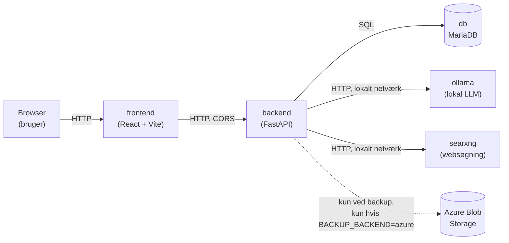

# Arkitektur

Se `SPEC.md` for den fulde tekniske spec og `docs/ai-log.md` for en fase-for-fase gennemgang af beslutninger og antagelser. Dette dokument giver et overblik over hvordan delene hænger sammen.

## Services



| Service | Rolle |
|---|---|
| `db` | MariaDB. Hardwareinventar (tabel `components`). |
| `backend` | FastAPI. Al forretningslogik: CRUD, kompatibilitetsmotor, LLM-pipeline, backup. |
| `ollama` | Lokal sprogmodel (default `qwen2.5:7b-instruct`). Kører **udelukkende** på home-serveren. |
| `searxng` | Websøgning til `/api/components/search` (hardwarespecifikationer). |
| `frontend` | Minimal React-UI. Taler direkte med `backend` fra browseren (ikke gennem en proxy). |

Alle services er defineret i `docker-compose.yml` og startes samlet med `docker compose up -d --build` (se README.md).

## To hovedflows

### 1. Tilføj komponent (søg → udtræk → bekræft)

```
Bruger skriver "RTX 2060 SUPER"
  → POST /api/components/search  → SearXNG → kandidatliste (titel + uddrag)
  → Bruger vælger en kandidat
  → POST /api/components/extract → Ollama udtrækker specs fra uddraget → vises til bekræftelse
  → Bruger bekræfter (og retter evt. antal/stand)
  → POST /api/components       → gemmes med specs_verified=true
```

Er `ENABLE_WEB_LOOKUP=false`, springes søgetrinnet over, og `/extract` beder i stedet Ollama om at gætte specs ud fra sin egen viden (`specs_source=llm_extracted`, stadig `specs_verified=false` indtil brugeren bekræfter).

### 2. Anbefal en build (fri tekst → verificeret build)

```
Bruger skriver "headless pc til lokal AI"
  → POST /api/recommend
    1. Ollama fortolker teksten til strukturerede krav (ProjectRequirements)
    2. Backend forfiltrerer lageret deterministisk (kvantitet > 0, ikke defekt, hårde minimumskrav)
    3. Kompatibilitetsmotoren (compatibility/) kombinerer kandidater og beholder kun verificerede builds
    4. Ollama rangerer de verificerede builds — opfundne build_id afvises
    5. Det/de valgte build(s) verificeres igen, før svaret returneres
  → Svar: builds (med regelresultater + advarsler), manglende kategorier, og status for hvert LLM-kald (ok/retried/fallback)
```

Kernepointet: **LLM'en foreslår, reglerne verificerer** (SPEC.md §2). Intet build returneres, uden at `compatibility/engine.py` selv har kørt alle regler på det.

## Datamodel

Se SPEC.md §4 for den fulde datamodel. Kort fortalt: én tabel `components` med en diskrimineret JSON `specs`-kolonne pr. kategori (cpu/motherboard/ram/gpu/storage/psu/case/cooler), valideret af Pydantic (`backend/app/schemas/components.py`) både ved skrivning og læsning.

## Sikkerhed og ansvarlig AI-brug (SPEC.md §9.3)

- **Al AI-inferens kører lokalt.** `ollama` kører på home-serveren, inden for det lokale Docker-netværk. Ingen prompt, projektbeskrivelse eller komponentdata sendes til en ekstern AI-tjeneste (OpenAI, Azure OpenAI, el.lign.).
- **Kun inventar-snapshots sendes til Azure**, og kun når `BACKUP_BACKEND=azure` er valgt eksplicit i `.env` — se `docs/ai-log.md`s fase 4-post. Det er ren inventardata (komponentnavne, specs, antal) — aldrig prompts, LLM-svar eller søgeresultater.
- **LLM-output stoler aldrig ufiltreret.** Alt struktureret LLM-output valideres med Pydantic; ugyldigt output giver én retry med fejlbesked, derefter en deterministisk fallback (se `backend/app/llm/parsing.py`). Rangeringens `build_id`'er valideres eksplicit mod den faktiske kandidatliste — et opfundet id afvises.
- **Prompt-injection.** Brugerstyret og websøgnings-tekst (komponentnavne, projektbeskrivelser, søgeresultat-uddrag) sendes til LLM'en indkapslet i `<data>`-blokke med en eksplicit instruktion om, at indholdet er data, ikke kommandoer. Literal `<`/`>` escapes, så en indlejret falsk lukke-tag ikke kan bryde ud af blokken (se `backend/app/llm/prompts.py` og dens tests).
- **`specs_verified`-flaget.** Specs fra LLM eller websøgning er altid `specs_verified=false`, indtil en bruger aktivt har bekræftet dem via frontenden.
- **Ingen secrets i repoet.** `.env` er git-ignoreret; `.env.example` indeholder kun placeholders. `GET /api/health`/`GET /api/backup` viser aktiv backup-destination, men aldrig connection-strings (testet eksplicit, se `test_api.py`).
- **CORS er sat til at tillade alle origins** (`allow_origins=["*"]` i `backend/app/main.py`), fordi frontend og backend kører på forskellige porte på en server, hvis LAN-adresse ikke er fast. Dette er en bevidst forenkling for en lokal/LAN-deployment, ikke en offentligt eksponeret tjeneste — ville være for løst til en produktionsdeployment med reelle brugere.
