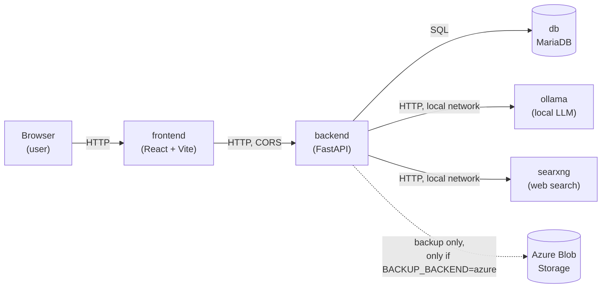

# Architecture

See `SPEC.md` for the full technical spec and `docs/ai-log.md` for a phase-by-phase walkthrough of decisions and assumptions. This document gives an overview of how the pieces fit together.

## Services



| Service | Role |
|---|---|
| `db` | MariaDB. Hardware inventory (`components` table). |
| `backend` | FastAPI. All business logic: CRUD, compatibility engine, LLM pipeline, backup. |
| `ollama` | Local language model (default `qwen2.5:7b-instruct`). Runs **exclusively** on the home server. |
| `searxng` | Web search for `/api/components/search` (hardware specifications). |
| `frontend` | Minimal React UI. Talks directly to `backend` from the browser (not through a proxy). |

All services are defined in `docker-compose.yml` and started together with `docker compose up -d --build` (see README.md).

## Two main flows

### 1. Add a component (search → extract → confirm)

```
User types "RTX 2060 SUPER"
  → POST /api/components/search  → SearXNG → candidate list (title + snippet)
  → User picks a candidate
  → POST /api/components/extract
    1. Ollama identifies the category alone, from a tiny schema (just "category")
    2. Ollama extracts the fields for that category, from a flat, single-category schema
       (not the full discriminated-union schema -- see Known risks in docs/ai-log.md)
  → Shown for confirmation
  → User confirms (and adjusts quantity/condition if needed)
  → POST /api/components       → saved with specs_verified=true
```

If `ENABLE_WEB_LOOKUP=false`, the search step is skipped, and `/extract` instead asks Ollama to guess specs from its own knowledge (`specs_source=llm_extracted`, still `specs_verified=false` until the user confirms).

### 2. Recommend a build (chat → verified build → optionally saved)

```
User types "headless pc for local AI"
  → POST /api/recommend {conversation: [...], max_builds}
    0. The backend flattens the conversation so far (user + assistant turns) into one transcript
    1. Ollama interprets the transcript into structured requirements (ProjectRequirements) —
       later user turns refine or override earlier ones, so the user can say
       "actually, make it as low-power as possible" on a second turn
    2. Backend deterministically prefilters the inventory (quantity > 0, not faulty, hard minimum requirements)
    3. The compatibility engine (compatibility/) combines candidates and keeps only verified builds
    4. Ollama ranks the verified builds — invented build_id values are rejected
    5. The chosen build(s) are re-verified before the response is returned
    6. Ollama writes a reply to the user's latest message, given the builds and their actual specs as
       context -- so a genuine question ("what model can I run on these?") gets answered, not just a
       restated build summary, and a game/software request gets that title's requirements explained
       alongside a comment on each build's chances (falls back to a deterministic summary if unavailable)
  → Response: builds (with rule results + warnings), missing categories, the chat reply
    (assistant_message), and the status of each LLM call (ok/retried/fallback)
```

The frontend's Recommend tab is a chat: every reply (including its builds) is appended to the conversation, and the next message's request carries the full history — so the user can keep refining a build across multiple turns instead of only getting one shot at a single prompt. The backend itself stays stateless; the frontend resends the whole conversation each turn.

Any build shown in the chat can be saved (`POST /api/builds`) to the **Builds** tab for later. A saved build can be marked as physically assembled (`POST /api/builds/{id}/complete`), which decrements the inventory quantity of each component it used by 1 — so a component that's now built into a PC stops showing up as available stock for future recommendations. Saved builds keep a snapshot of their components, so they stay displayable even if a component is later edited or deleted.

The core point: **the LLM proposes, the rules verify** (SPEC.md §2). No build is ever returned without `compatibility/engine.py` itself having run every rule against it.

## Data model

See SPEC.md §4 for the full data model. In short: a single `components` table with a discriminated JSON `specs` column per category (cpu/motherboard/ram/gpu/storage/psu/case/cooler), validated by Pydantic (`backend/app/schemas/components.py`) both when writing and reading.

A `saved_builds` table (added for the Builds tab, outside SPEC.md's original scope) holds builds the user chose to keep: a JSON snapshot of their components, an optional reason/name, and a `completed`/`completed_at` pair set when the build is marked as physically assembled.

## Security and responsible AI use (SPEC.md §9.3)

- **All AI inference runs locally.** `ollama` runs on the home server, inside the local Docker network. No prompt, project description, or component data is ever sent to an external AI service (OpenAI, Azure OpenAI, or similar).
- **Only inventory snapshots are sent to Azure**, and only when `BACKUP_BACKEND=azure` is explicitly selected in `.env` — see `docs/ai-log.md`'s Phase 4 entry. That's pure inventory data (component names, specs, quantities) — never prompts, LLM responses, or search results.
- **LLM output is never trusted unfiltered.** All structured LLM output is validated with Pydantic; invalid output gets one retry with the validation error fed back, then a deterministic fallback (see `backend/app/llm/parsing.py`). The ranking's `build_id` values are explicitly validated against the actual candidate list — an invented id is rejected.
- **Prompt injection.** User-controlled and web-search text (component names, project descriptions, search result snippets) is sent to the LLM wrapped in `<data>` blocks with an explicit instruction that the content is data, not commands. Literal `<`/`>` are escaped so an embedded fake closing tag can't break out of the block (see `backend/app/llm/prompts.py` and its tests).
- **The `specs_verified` flag.** Specs from the LLM or web lookup are always `specs_verified=false` until a user has actively confirmed them via the frontend.
- **No secrets in the repo.** `.env` is git-ignored; `.env.example` contains only placeholders. `GET /api/health`/`GET /api/backup` show the active backup destination, but never connection strings (explicitly tested, see `test_api.py`).
- **CORS is set to allow all origins** (`allow_origins=["*"]` in `backend/app/main.py`), because the frontend and backend run on different ports on a server whose LAN address isn't fixed. This is a deliberate simplification for a local/LAN deployment, not a publicly exposed service — it would be too permissive for a production deployment with real users.
